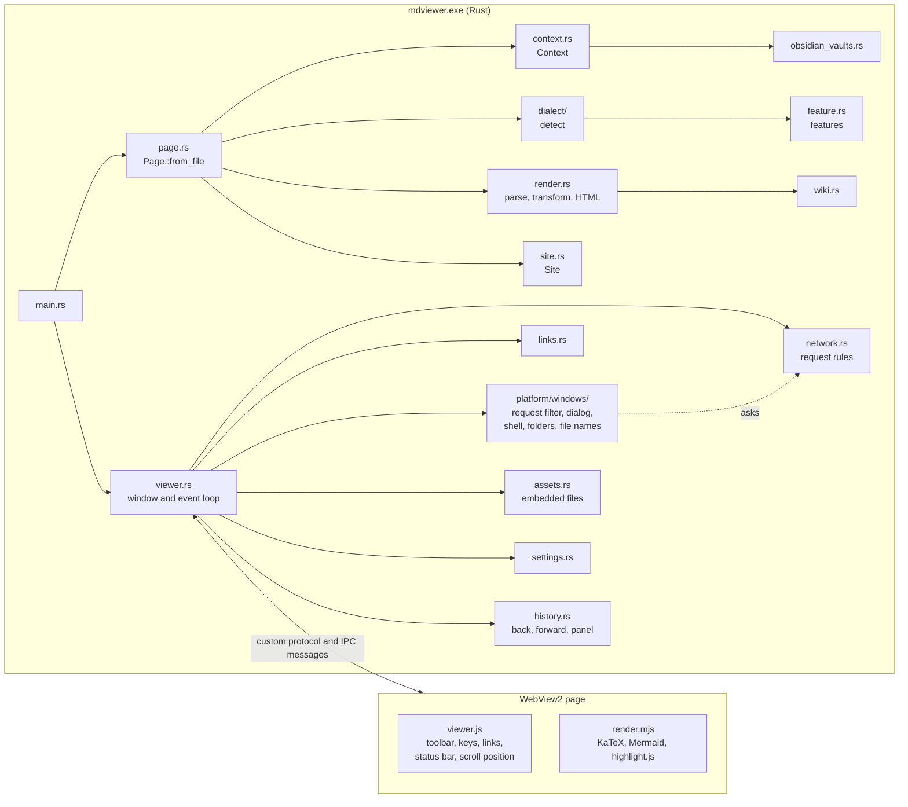
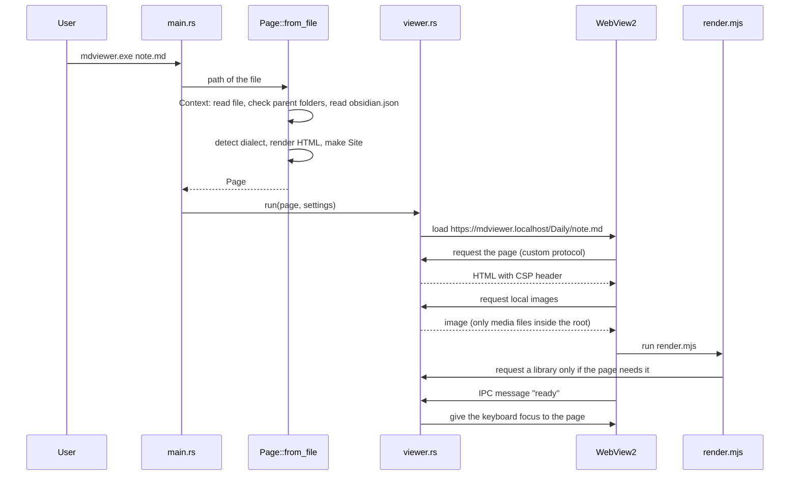
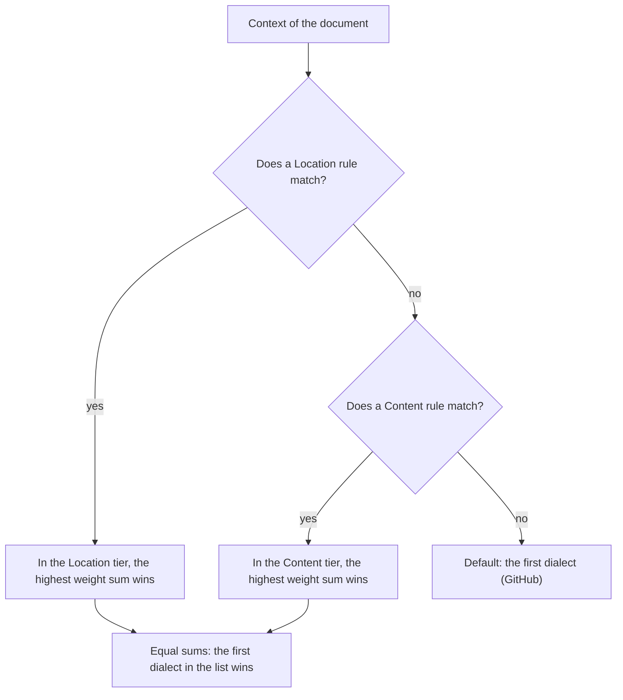
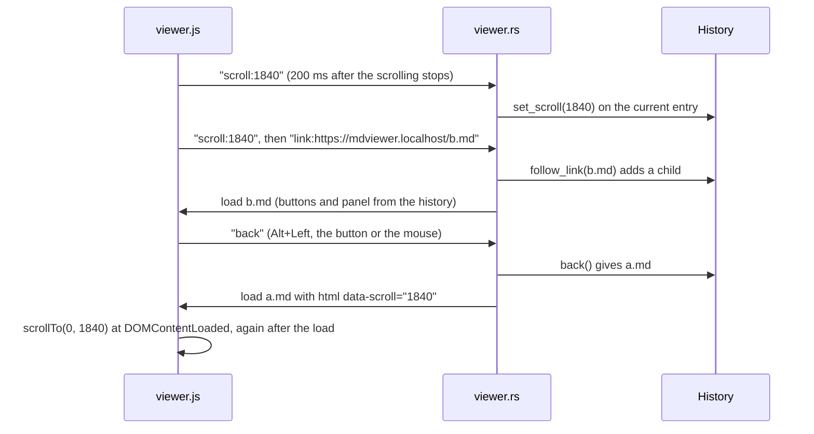
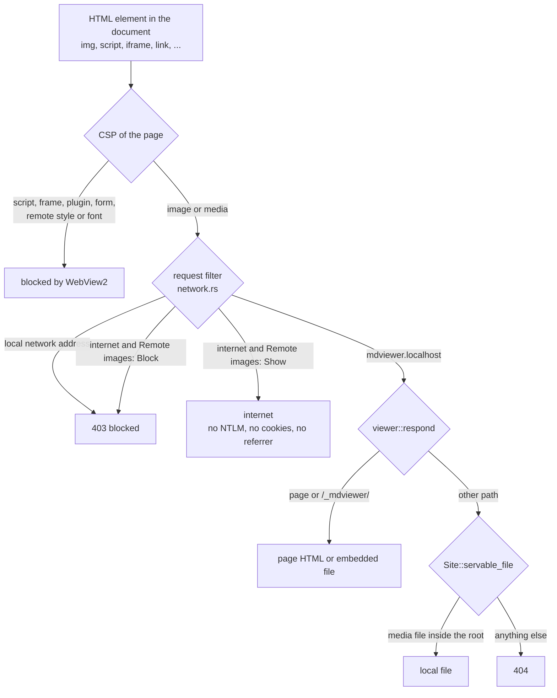

# mdviewer architecture

This document explains how mdviewer works and why it works that way. It is for
developers. For users, see the [README](../README.md).

## Goals and limits

- **Fast and small.** Open a file from File Explorer and see it in less than a second.
  Use few dependencies.
- **Read-only.** mdviewer shows files and never changes them.
- **Full Markdown.** Markdown files can contain raw HTML, so a real HTML engine shows
  them: Microsoft Edge **WebView2**, through the Rust crates `wry` and `tao`.
- **Two dialects, more later.** GitHub and Obsidian. The dialect is detected
  automatically. A new dialect is a new data constant, not new code paths.
- **Untrusted documents.** A document can contain any HTML. It must not run code, read
  other files, send requests into the local network, or send the Windows login.
- **Privacy.** When a page opens, mdviewer does not list the user's folders.

## Overview

mdviewer is one Rust program. It makes an HTML page from the Markdown file, and a
WebView2 window shows the page. The page gets all its content from mdviewer through a
custom protocol (`https://mdviewer.localhost/`), never from a web server.



## Modules

| Module | Job |
|---|---|
| `main.rs` | Starts the log, reads the settings, makes the first page, opens the window. |
| `context.rs` | `Context`: the facts about one document (path, text, text without code, vault, repository, line-break setting). Rules and features only read it. |
| `obsidian_vaults.rs` | Reads Obsidian's vault list (`obsidian\obsidian.json` in the configuration folder; on Windows `%APPDATA%`). |
| `dialect/` | `Dialect` and `Rule` (data), and `detect`. One file for each dialect. `choices.rs`: the manual choice for each folder (`dialects.ini`). |
| `feature.rs` | `Feature` trait: sets comrak options, can change the parsed document. |
| `render.rs` | Markdown to HTML: parse, let features change the tree, write HTML. |
| `wiki.rs` | Resolves Obsidian wiki links and embeds (direct checks; search only on click). |
| `page.rs` | `Page`: title, HTML body, path, vault, site, dialect selection. Builds the full HTML document with the toolbar, the back and forward buttons and the history panel. |
| `history.rs` | `History`: the tree of the visits of one session (back, forward, the panel, scroll positions). |
| `site.rs` | `Site`: the page URL and the rules for local files. |
| `viewer.rs` | The window, the web view, the protocol handler, the CSP, the event loop. |
| `network.rs` | The rules for network requests (the request filter of the platform asks them). |
| `links.rs` | What a link click does. |
| `platform/` | The code that is different on each operating system (see [Platforms](#platforms)). Only `platform/windows/` exists: the WebView2 options and request filter, the "Open" dialog, the Shell calls (open a link, show in File Explorer, work area), the base folders, and the Windows file-name rules. |
| `assets.rs`, `build.rs` | The embedded browser files: our scripts and the libraries in `assets/vendor`. |
| `settings.rs`, `paths.rs`, `logging.rs` | Settings file, program folders, log file. |
| `assets/viewer.js` | Page script added by the web view: toolbar, keys, link clicks, link preview, history panel, scroll position, notices. |
| `assets/render.mjs` | Content script of the page: loads KaTeX, Mermaid or highlight.js only when needed. |
| `assets/style.css` | The page style, light and dark. |

The `unsafe` code is only in `platform/windows/` (`request_filter.rs`, `dialog.rs`,
`shell.rs`). Each of these files only connects tested decisions (in other files) to
Windows.

## Opening a document



The page HTML is built again for each request of the page, from the current settings.
Thus, a reload after a settings change shows the new state.

## Dialect detection

A `Dialect` is data: an id, a name, a list of `Rule`s and a function that gives the
features for a document. A `Rule` has a **tier**, a **weight**, a **reason** (for the
log) and a **test** (`fn(&Context) -> bool`).



The tiers prevent many weak signals from winning against one strong signal. For
example, Obsidian syntax in a Git repository (Content) does not win against the
repository (Location).

| Dialect | Location rules | Content rules |
|---|---|---|
| GitHub | Git repository (50) | typical file name, for example `README.md` (10) |
| Obsidian | `.obsidian` folder above the file (100); vault in `obsidian.json` (100) | wiki links (10), Obsidian callout (10), `==highlight==` (5), `%%comment%%` (5) |

Content rules read the text **without code** (`Context::prose`), so that syntax in a
code example does not count.

**How the vault is found.** The viewer checks each parent folder of the file for an
`.obsidian` folder and stops at the first one. These are at most as many checks as the
path has folders, and no folder is listed. Obsidian always keeps `.obsidian` in the
vault root, so the upward search always finds it. The second signal, Obsidian's own
vault list, also finds a vault whose settings folder has another name ("Override config
folder").

**To add a dialect:** write `src/dialect/<name>.rs` with a `DIALECT` constant (rules and
a feature list), and add it to `DIALECTS` in `src/dialect/mod.rs`. The "Dialect"
selector and the `dialects.ini` file then know it too.

### Manual choice

The user can override the detection with the **Dialect** selector in the toolbar
(`src/dialect/choices.rs`). The choice is saved for the **folder of the document** and is
valid for its subfolders. The nearest saved folder wins:

| Saved in `dialects.ini` | File | Dialect |
|---|---|---|
| `D:\Notes = obsidian` | `D:\Notes\Daily\a.md` | Obsidian (parent folder) |
| `D:\Notes = obsidian`, `D:\Notes\Code = github` | `D:\Notes\Code\x\b.md` | GitHub (nearest folder) |
| `D:\Notes = obsidian`, `D:\Notes\Code = auto` | `D:\Notes\Code\c.md` | detected |

- **"Auto"** removes the entry of the folder. If a parent folder still has a dialect,
  `auto` is saved, so that the detection really decides there.
- **The detection always runs**, also with a manual choice. The selector shows the
  detected dialect ("Auto (Obsidian)"), and the log has both the choice and the
  detected dialect with its reasons.
- **The file:** one line `<folder> = <id>` for each folder, split at the **last** `=`
  (a folder name can contain `=`, an id cannot). Relative folders and unknown ids are
  ignored with a warning. A folder with a line break in its name is not saved, so that
  it cannot add a line. At most 1000 folders (`MAX_FOLDERS`); the oldest choice goes
  first. The file is written to a temporary file first, then renamed.
- **The flow:** the page script sends the scroll position, then `dialect:<id>`. Rust
  saves the choice, makes the page again with `Page::from_file`, and reloads. The
  history does not change (it is the same file).
- **Privacy:** the tooltip says "chosen for this folder" or "for a parent folder", but
  never the path (see the history panel: CSS can read attributes).

## Rendering

`render.rs` uses comrak in three steps:

1. **Parse** the Markdown into a tree, with the options of the dialect's features.
2. **Transform:** each feature can change the tree (`Feature::transform`). Only
   `WikiLinks` does this now.
3. **Write** the HTML.

**Wiki links** (`wiki.rs`). When a page opens, the viewer checks only these exact
places, and it lists no folder:

1. a relative path in the link (`[[./x]]`, `[[../x]]`), from the note folder;
2. the note folder;
3. the vault root with the path in the link (`[[folder/note]]`);
4. Obsidian's attachment folder (`attachmentFolderPath` in `.obsidian/app.json`).

A found link becomes a normal link (an image for `![[image.png]]`). A link that is not
found stays a wiki link, and the CSS shows it faded. A click on it sends the target to
Rust, and only then does `wiki::search` list the vault (at most 50,000 files; hidden
folders, `node_modules`, links and junctions are skipped). The order is the one that
Obsidian uses: the same folder, then the shortest path, then alphabetical order.

**Icons of alerts and callouts** are CSS only (`style.css`): each title has a
`::before` element whose mask is an SVG icon and whose color is the text color. Thus,
the icons are monochrome in the color of their block, in both themes. GitHub alerts use
Octicons (as GitHub), Obsidian callouts use Lucide (as Obsidian), with Obsidian's
mapping from callout type to icon. A test checks that every icon that the CSS names is
embedded.

**Math, diagrams and code colors** are done in the page by `render.mjs`. It looks at
the page and loads a library only if the page needs it: KaTeX for `[data-math-style]`,
Mermaid for ```` ```mermaid ````, highlight.js for other code blocks with a language.
Mermaid is the ESM build: a page loads only the parts that its diagrams need (a page
with two diagrams loaded 39 of 132 files, 3.1 of 6.1 MB).

## The page

**Address.** The page URL follows the position of the document below its **root
folder**: the outer one of the vault and the Git repository, or the document folder.
For `D:\Notes\Daily\today.md` with the root `D:\Notes`, the page is
`https://mdviewer.localhost/Daily/today.md`. Thus, the browser resolves relative paths
(`../img/a.png`) exactly as the file system does.

**What the protocol handler answers** (`viewer::respond`), in this order:

1. the page itself;
2. `/_mdviewer/…`: an embedded file (our scripts, the libraries). This path is
   **reserved**: it never serves a file from the document folder, because the CSP
   allows scripts from it;
3. a local image or media file inside the root (`Site::servable_file`);
4. everything else: 404.

**Two scripts.**

- `viewer.js` is added by the web view to every page before the page loads. It works
  only on `https://mdviewer.localhost`. It handles the toolbar, the keys, the link
  clicks and the notices. It sends messages to Rust through IPC (`window.ipc`).
- `render.mjs` is a normal module script of the page, from `/_mdviewer/`.

**Messages from the page** (IPC): `ready`, `close`, `open`, `back`, `forward`,
`history:<node id>`, `scroll:<pixels>`, `panel:<id>`, `panelwidth:<pixels>`, `theme:<id>`,
`images:<id>`, `link:<url>`, `wikilink:<target>`, `error:<text>`. Rust accepts them only
from the current page URL, and it ignores unknown messages.

**Links.** The page script sends every link click to Rust. The navigation handler is
not used for this, because a `<meta refresh>` would then open a website without a
click. `links::classify` decides:

| Link | Action |
|---|---|
| `http`, `https`, `mailto` | Open in the default program. |
| Local `.md` file | Open in the viewer. Only these files go into the history. |
| Other local file or folder | Show in File Explorer. Never run it. |
| `file://server/…` | Blocked: Windows would connect and send the login (NTLM). |
| Any other scheme (`javascript:`, `ms-msdt:`, …) | Blocked. |

**Link preview.** When the mouse is on a link (or the keyboard focus), `viewer.js`
shows its address at the bottom left. A web or mail address shows exactly as the click
sends it (`link.href`, not decoded: the browser encodes all characters that are not
ASCII). A local link shows its decoded path below the root, without Unicode direction
characters. An unresolved wiki link shows `Search the vault: <target>`.

## History

`history.rs` keeps the history of one window, in memory only. Only files that the
viewer shows are in it. The history is a **tree of visits**: a node is one visit, not
one file. Each visit has exactly one parent (the page where the link was clicked), so
the structure is always a tree, also when notes link to each other in a circle. A file
that was opened from two notes is two nodes; the panel fades the later line.

| Action | Effect on the tree |
|---|---|
| Link to a new file | A new child below the current node. |
| Link to the current file or a file above it in the branch | Go up to that node. No new node: a circle A → B → A stays A → B. |
| Link to the file of a child of the current node | Go to that child. No new node: more clicks between A and B do not grow the tree. |
| "Open…", drag and drop | Clear the history; it starts again with only this file (the user's choice). |
| Back | Go to the parent. |
| Forward | Go to the child that was visited last (`last_child`). |
| Click in the panel | Go to that node (by node id). |

A node that the viewer goes back to keeps its scroll position; a link with a heading
sets it to 0, so that the page goes to the heading. No navigation removes a branch (a
browser removes the "forward" entries). Only the limit of 200 nodes removes the oldest
node; its children take its place, so that a long chain of links also becomes shorter.
Removed nodes leave an empty place, so that the ids in the panel stay correct.

The panel lists the nodes in the order of the visits, each node before its children.
It indents 12 px for each level, up to 8 levels (`page::MAX_PANEL_DEPTH`), because the
panel is narrow (260 px by default). The user can drag its right edge (`#mdviewer-resizer`, an ARIA `separator` that also works with the arrow keys).



The page script sends the scroll position again before each message that can show
another page, so that the position is correct also if the scrolling stopped less than
200 ms before the click. The page gets the position in `<html data-scroll>`, not from a
script call after "ready", so a reload ("Remote images") also comes back to the same
place.

## Security

A document is untrusted. comrak copies raw HTML to the output (its tag filter was
removed in comrak 0.56), so the protection comes from these layers:



| Threat | Protection | Proof |
|---|---|---|
| Scripts in the document | CSP: `script-src` only `/_mdviewer/`; no inline code, no `eval` | unit tests on the CSP; window test with `<script>`, `onerror`, `javascript:` |
| Frames, plugins, forms | CSP: `default-src 'none'`, `form-action 'none'`, `base-uri 'none'` | unit tests; a note replaces blocked frames |
| Windows login (NTLM) sent to an image server | `--auth-server-allowlist=mdviewer.invalid` | experiment with a test server: without the option, WebView2 sent a `Negotiate` token; with it, nothing |
| Requests into the local network (for example `https://192.168.1.1/reboot`) | request filter, also for unusual forms (`0x7f.1`, `[::ffff:127.0.0.1]`) | unit tests; a TCP listener got 0 connections from 6 attack requests |
| Tracking by image servers | "Remote images: Block" removes `https:` from the CSP, and the filter blocks the internet | window test |
| Cookies of image servers | InPrivate mode | configured |
| Local files outside the root, or of other types | `Site::servable_file`: resolved path inside the root, media types only | unit tests with `..`, `%2E%2E`, `%5C`, drive letters, `a.png:stream`, `CON`, a junction |
| Page text sent out with CSS or fonts | no remote styles, no document fonts (`font-src 'self'`) | unit tests on the CSP |
| Downloads, new windows, permissions | all blocked | window test with a download link |
| Dangerous link schemes (`ms-msdt:`, `search-ms:`) | only `http`, `https`, `mailto` (checked in `links.rs` and again in `platform::open_external`) | unit tests |
| A local program started from a link | other local files are only shown in File Explorer | window test with an `.exe` link |
| Fake log lines from a document | page error texts lose control characters and are cut to 300 characters | unit tests |
| Messages from a frame | Rust accepts IPC only from the current page URL | unit tests |
| KaTeX and Mermaid features that run code | KaTeX `trust: false`; Mermaid `securityLevel: "strict"` | JavaScript tests; window test with `\href{javascript:…}` |
| A link preview that hides the real host (for example with U+202E) | web addresses are not decoded; direction characters are removed from local paths | JavaScript tests |
| File paths (the user name) sent out with CSS attribute selectors | the history panel has paths only as text; a click sends an index, not a path; the "Dialect" tooltip names no folder | unit tests: no path in any attribute |
| A document element that looks like a panel entry | only entries inside the real panel (`getElementById`, before the document) count | JavaScript test |

## Settings, logging and folders

- Dialect choices: `%APPDATA%\mdviewer\dialects.ini`, a separate file because it is a
  list that grows (see [Manual choice](#manual-choice)).
- Settings: `%APPDATA%\mdviewer\settings.ini` (`key = value` lines, no extra crate). A
  new setting is a `Choice` (`settings.rs`); the toolbar makes its selector from it.
  `history_panel` and `history_panel_width` save only the state and the width of the
  panel; the history is never saved. The width is a number (`PanelWidth`, 160 to 800 px),
  not a `Choice`; the page script uses the same limits (a test checks them).
- Window: it opens hidden, moves to the center of the work area (the screen without
  the taskbar), then shows. Before this, Windows put the bottom 40 pixels of the window
  behind the taskbar on a 1920 x 1080 screen, which hid the link preview.
  If `window = maximized`, it maximizes after the move (so "Restore down" gives the
  centered window). On close, `WindowState::when_closed` saves the state; a minimized
  window keeps the old state, because Windows does not say whether it was maximized.
- Panel width: CSS `--panel-size` = `clamp(160px, --panel-width, 100vw - 600px)`. The
  page keeps `page::MIN_PAGE_WIDTH` (600 px, about 65 characters of text); the page
  script uses the same limit, and a test checks that both agree.
- Log: `%LOCALAPPDATA%\mdviewer\logs\mdviewer.log`, level from `MDVIEWER_LOG`. A panic is
  written to the log. A logging error never stops the viewer.
- WebView2 data: `%LOCALAPPDATA%\mdviewer\WebView2`. Without it, WebView2 would write
  next to the program, which fails in `Program Files`.
- The base folders (`%APPDATA%`, `%LOCALAPPDATA%`) come from `platform`; `paths.rs` adds
  `mdviewer` and refuses a missing or relative folder, on all systems.

## Platforms

Only Windows is supported now. All code that is different on each operating system is
in `src/platform/`; `src/platform/mod.rs` lists the items that each platform must give.
On another system, the build stops with a `compile_error!` that points here. The
Windows crates (`windows`, `windows-core`, `webview2-com`) are Windows-only dependencies.

The shared modules keep all decisions (which link opens, which request is blocked,
which file a page can load). The platform module only does the system call. Thus, the
security rules stay the same on each system.

A port to macOS (WKWebView) or Linux (WebKitGTK) must add `platform/macos/` or
`platform/linux/` and also solve these points:

| Point | Why |
|---|---|
| Request filter | wry has no request filter for WebKit. macOS: `WKContentRuleList`; Linux: `WebKitUserContentFilter`. Both see only the address text, not the resolved IP address, so they are weaker. Until a filter exists, remote images must stay blocked (fail closed). |
| `ORIGIN` | WebKit keeps `mdviewer://localhost`. `assets/viewer.js` has the Windows origin as text (a test checks that it is the same as `site::ORIGIN`); a port must give the origin to the script. `network::PAGE_HOST` is also the Windows host. |
| File names | Linux file names are case-sensitive (`platform::same_name`). Many tests use Windows paths (`D:\…`); the tests of Windows-only behavior have `#[cfg(windows)]`. |
| Keys | macOS uses Cmd+O, Cmd+W, Cmd+[ and Cmd+]. |
| File association | macOS: `.app` bundle with `Info.plist` and the "open file" event. Linux: a `.desktop` file. |
| CSS | `light-dark()` and `mask` need Safari 17.5 or a recent WebKitGTK. |
| Memory and start time | The measurements are for WebView2 only. |

## Tests

- **Rust unit tests** in each module (`cargo test`). Tests that need files use temporary
  folders (`test_util::TempDir`). The tests must give the same result on each computer:
  - A test that examines parent folders stops at its temporary folder
    (`Context::with_ceiling`, `Context::load_in`). A `.git` or `.obsidian` folder above
    `%TEMP%` (for example a home folder in Git) must not change the result.
  - Tests never read the files of the user, for example Obsidian's vault list. They give
    their own list (`Context::load_in(path, ceiling, &[])`).
  - Each temporary folder has a space, `'`, `é` and `&` in its name, so that all tests
    with files also check user names such as `O'Brien`.
  - Paths such as `D:\Notes` occur only in tests that do not use the disk. The drive does
    not have to exist. They are invented: the code never contains real personal paths.

  On 2026-11-09, the unit tests passed with `%TEMP%` in a Git repository, in a vault,
  with `'é&` in the path, and with an Obsidian list that makes `C:\` a vault.
- **JavaScript tests** (`tests/js/*.test.mjs`) run the real page scripts in Node.js with
  small fakes of the document and the libraries. No npm packages are necessary.
  `tests/page_script.rs` starts them, so `cargo test` runs all tests. As in WebView2, the
  fake has no `<html>` element while `viewer.js` starts (a window test found this error).
- **Lints:** `cargo clippy --all-targets -- -D warnings` fails for any warning, also for
  an item without a doc comment (`missing_docs`, `missing_docs_in_private_items`).
- **CI** (`.github/workflows/ci.yml`): GitHub Actions on `windows-latest` runs
  `cargo fmt --check`, clippy, `cargo test` (with Node.js 24) and `cargo doc`, all with
  `--locked`. It uses only official GitHub actions, each pinned to a commit hash, and
  only reads the repository. The runner's `%TEMP%` usually has a short 8.3 name
  (`C:\Users\RUNNER~1\...`), so CI also checks the tests with short paths.
- **Release** (`.github/workflows/release.yml`): runs only when a release is published
  on GitHub. Job 1 checks that the tag is the `Cargo.toml` version
  (`.github/scripts/check-release-version.ps1`). Job 2 calls `ci.yml` itself
  (`workflow_call`), so a release always runs the same checks. Job 3 builds with
  `--release --locked`, packs the zip with all licenses and notices
  (`.github/scripts/package-release.ps1`), and uploads it with `gh release upload`. Only
  job 3 has `contents: write`. The two scripts were tested by hand (correct and wrong
  tags; zip content; `sha256sum -c`; no local paths and correct UTF-8 in the notices).
- **Licenses** (`tools/notices.mjs`, tested in `tests/js/notices.test.mjs`): makes the
  notices of the Rust crates (from `cargo metadata`: normal dependencies only, no
  proc-macro crates) and of the npm packages inside Mermaid, and accepts only the
  licenses in `ACCEPTED_LICENSES`. Other cases need a reviewed entry with the exact
  version (`REVIEWED_PACKAGES`). CI runs `node tools/notices.mjs cargo --check`.
  `tests/licenses.rs` checks that `LICENSE`, each vendor `LICENSE`, `katex/OFL.txt` and
  the Mermaid notices are in the repository.
- **Window tests** were done by hand with PowerShell scripts that start the viewer, send
  keys and clicks, and take screenshots. These scripts check before each key that the
  viewer is the front window.

## Measurements (2026-11-06)

| | Value |
|---|---|
| Time to the first page (warm start) | about 750 ms |
| Memory of a page with code (all processes) | about 119 MB |
| Memory of a page with math and diagrams | about 147 MB |
| Memory of mdviewer's own process | about 6 MB |
| Program size | 8.4 MB (Mermaid alone is 5.4 MB) |

## Decisions

| Date | Decision | Reason |
|---|---|---|
| 2026-11-05 | WebView2 (`wry`, `tao`), not native drawing | Markdown can contain any HTML; only a real HTML engine shows it fully. Measured memory: 164 MB by default, 94 MB with the GPU off and one renderer process. |
| 2026-11-05 | `Dialect` is data, `Feature` is a trait | A dialect has no behavior of its own; features set options and change the tree. |
| 2026-11-05 | Tiers in detection | A strong signal (a folder) must win against many weak signals (syntax). |
| 2026-11-05 | Own logger on the `log` facade, no logging crate | Few dependencies; a log file is necessary because release builds have no console. |
| 2026-11-06 | Page from a custom protocol, not `with_html` | `with_html` has a 2 MB limit, and the protocol also serves libraries and images. |
| 2026-11-06 | `--auth-server-allowlist`, InPrivate mode, request filter | Remote images are allowed, and an experiment showed the NTLM leak. |
| 2026-11-06 | Theme with `data-theme` and CSS `light-dark()` | The WebView2 color setting had no effect in InPrivate mode; one value for each color. |
| 2026-11-06 | Native "Open" dialog (`windows` crate), not an HTML file input | The viewer needs the path (dialect, images); `windows` is already a dependency of wry. |
| 2026-11-06 | Libraries embedded; Mermaid as ESM build | No network needed; a page loads only the parts that it uses. Versions at least two weeks old. |
| 2026-11-06 | `obsidian.json` as a second vault signal | It is Obsidian's own record and covers renamed settings folders. |
| 2026-11-06 | No folder listing on open; vault search only on a click | Privacy: the user must not find that a viewer read the names of all files in the vault. |
| 2026-11-06 | Link clicks through the page script, not the navigation handler | Only real clicks may open programs or websites. |
| 2026-11-06 | Alert and callout icons from Octicons and Lucide, as CSS masks | Each block looks as in its own program; masks make the icons monochrome without changes to the HTML or scripts. |
| 2026-11-06 | Two history lists: browser back and forward, and a panel with each visited file (replaced the same day, see the next line) | The back and forward list loses entries after a new navigation; the panel must show all files of the session. |
| 2026-11-06 | History as a tree of visits, not of files; links to an ancestor or to a child of the current node add no node | A tree of files would be a graph (two notes link to the same file). One tree does back, forward and the panel, and loses no branch. Without the two rules, notes that link to each other would grow the tree with each click. |
| 2026-11-06 | No automatic link tree (all links of all linked notes) | It would read most of the vault on open (privacy), it grows very fast, and links make a graph with circles. |
| 2026-11-06 | "Open…" and drag and drop clear the history | The user's choice: a file that is opened this way starts a new reading session. |
| 2026-11-06 | Resizable panel; the width is saved only when the drag stops | Long file names and paths; one settings write for each drag, not for each mouse move. |
| 2026-11-06 | The panel leaves at least 600 px for the page | The document has a maximum width, so a wide panel makes its lines short; 600 px keep about 65 characters. A smaller window narrows the panel without a change to the saved width. |
| 2026-11-06 | Remember only "maximized", automatically, when the window closes | The user asked for it; most Windows programs do it without an option. Size and position are not saved (not asked for). |
| 2026-11-06 | History in memory only; only the panel state is saved | The user wants the history to end with the window. |
| 2026-11-06 | Scroll position in the history entry, sent to the page as `data-scroll` | "Back" must go to the same place; the attribute also works for a reload. |
| 2026-11-06 | Window centered in the work area | The status bar at the bottom must not be behind the taskbar. |
| 2026-11-09 | All system code in `src/platform/`, selected with `cfg`; free functions, not a trait | A later port to macOS or Linux adds one folder. Only one platform is in a build, so a trait gives nothing. The decisions stay in the shared code, so the security rules are the same on each system. |
| 2026-11-09 | `compile_error!` on systems other than Windows | Without a platform module, the build would fail with many unclear errors. Nothing is tested on other systems, so a build there must not seem to work. |
| 2026-11-09 | Manual dialect choice saved for the document folder and its subfolders; the nearest folder wins | Wrong detection happens mostly in plain folders without a vault or repository, so "the whole vault" would not help. A rule for each folder is easy to predict. |
| 2026-11-09 | `dialects.ini` separate from `settings.ini`, split at the last `=` | `settings.ini` has fixed keys; this is a list that grows. Folder names can contain `=`, dialect ids cannot. |
| 2026-11-09 | Detection runs also with a manual choice | The selector shows what "Auto" would give, and the log shows both. The cost is a few microseconds. |
| 2026-11-09 | Tests stop the folder search at their temporary folder and do not read Obsidian's real vault list | An experiment showed 6 failed tests when `%TEMP%` was in a Git repository, in a vault, or had `'` and `&` in its path. The program was correct; the tests depended on the computer. |
| 2026-11-10 | Release as a zip file (exe, README, library licenses), built by GitHub Actions | The licenses of KaTeX, Mermaid, highlight.js, Octicons and Lucide require their notices with each copy. A build on GitHub has no personal paths of the developer's computer in the exe. |
| 2026-11-10 | mdviewer uses the MIT license; the copyright holder is the GitHub name of the author | The author chose MIT. The code must not contain personal data, so the public GitHub name is used, not a real name. |
| 2026-11-10 | The notices of the Rust crates are made at each release from `Cargo.lock`, not committed | A committed list becomes wrong after `cargo update`. CI checks the licenses on each push, so a problem shows early. |
| 2026-11-10 | The Mermaid notices are committed, made from an npm install with `--before` the Mermaid publish date | The Mermaid files are committed too and change only with Mermaid. npm cannot give the exact versions of the Mermaid bundle (it was built from Mermaid's own lock file), so the file says that patch versions can differ; the licenses do not. |
| 2026-11-10 | Keep ELK (EPL-2.0) inside Mermaid, with the source address in the notices | EPL-2.0 does not change the license of mdviewer; it asks for the license text and the place of the source code. Removing the 1.6 MB chunk would break diagrams with `layout: elk`; this can be decided later. |
| 2026-11-10 | The KaTeX fonts get their own `OFL.txt` | The fonts use the SIL OFL 1.1 (their own metadata says so), not KaTeX's MIT license, and the npm package has no OFL text. |
